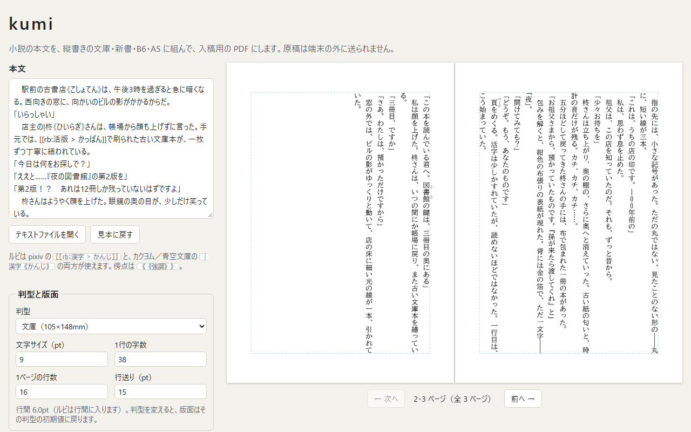
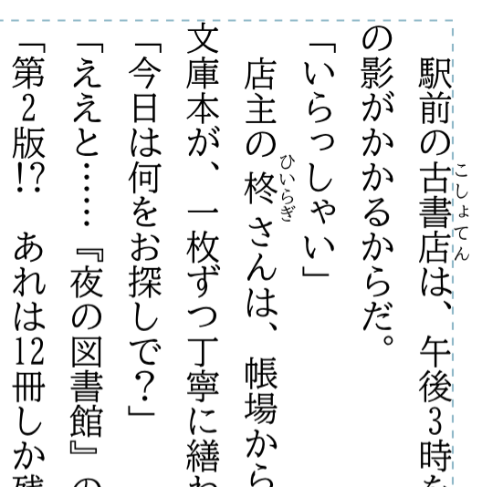
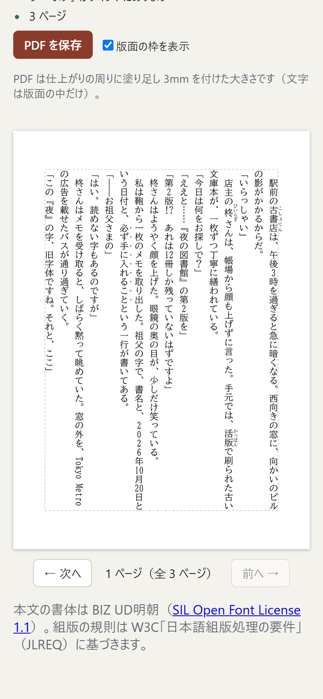

# kumi

小説同人誌の本文を、ブラウザの中だけで縦書きに組み、フォントを埋め込んだ入稿用の PDF にするツール。

**アプリ:** https://tame0522works-art.github.io/kumi/ （PC とスマホのブラウザで、開くだけで使える。開くと書き下ろしの見本が組まれた状態で始まる）



pixiv やカクヨムに載せている原稿を貼り付けると、ルビや傍点の記法をそのまま読んで組む。
組版は W3C「日本語組版処理の要件」（JLREQ）の規則を自前で実装した（ブラウザの縦書き表示には頼らない）。
原稿はどこにも送らない。公開版は Content Security Policy で通信そのものを禁止している。

## できること

| 組みの細部 | スマホ |
|---|---|
|  |  |

- **投稿サイトの記法をそのまま読む**: pixiv の `[[rb:漢字 > かんじ]]`、カクヨム／青空文庫の `｜漢字《かんじ》`（親文字が漢字だけなら `漢字《かんじ》`）、カクヨムの傍点 `《《強調》》`、`《` そのものを書く `｜《`
- **判型と版面**: 文庫・新書・B6・A5 から選び、文字サイズ・1行の字数・1ページの行数・行送りを変えられる。新書は印刷所ごとに寸法が違うので（日光企画 105×175、ポプルス 107×175、緑陽社 114×182、しまや出版 107×172 mm）、印刷所を選ぶ
- **見開きのプレビュー**: 右綴じなので奇数ページが左に来る。スマホでは1ページずつ。左右の矢印キーでもめくれる
- **入稿用の PDF**: 使った字だけを埋め込んだ縦書きの PDF（塗り足し 3mm 付き）。文字は画像ではなく文字のままなので、PDF から本文を検索・コピーできる
- **知らせること**: フォントにない字（豆腐になる字。押すとそのページへ移る）と、版面の外の余白が 10mm より狭いとき
- **テキストファイルを開ける**: UTF-8 で読めなければ Shift_JIS として読む（青空文庫の配布形式）

## 作りの要点

### 組版は JLREQ の文字クラスから決める

字を JLREQ の文字クラス（始め括弧・終わり括弧・句点・読点・中点・分離禁止・小書きの仮名など）に分け、禁則も約物の空きも、すべてこの分類から決める（[`src/layout/classes.ts`](src/layout/classes.ts)）。

- **約物の空き**: 括弧・句読点の字面は全角の枠の半分で、残り半分が空き。`」「` の間は二分、`。」` や `「「` の間はベタにする（[`src/layout/units.ts`](src/layout/units.ts)）
- **行の調整**（[`src/layout/lines.ts`](src/layout/lines.ts)）: 字数を超えるところで、禁則に触れないよう次の順に試す
  1. 句読点が行頭に来るなら、行末の外にぶら下げる
  2. 約物の空きを詰めて、次の分割できる位置まで追い込む（句点の後ろは詰めない）
  3. それも無理なら、前の分割できる位置まで追い出し、足りない分を字間に配って行末をそろえる
- **禁則**: 終わり括弧・句読点・中点・？！・小書きの仮名・長音は行頭に置かない（強い禁則）。始め括弧は行末に置かない。`――` と `……` は2字で1組なので分けない
- **行頭の始め括弧**: 行の途中で折り返した行頭は天付き（空きを取る）、段落の頭は全角のまま
- **ルビ**: 親文字より短ければ 1:2:1 で配る。長ければ前後の仮名・約物に四分まではみ出させ、それでも余る分は親文字の間を空ける。傍点は1字ずつのルビ（﹅）として付けるので、語の途中でも改行できる
- **縦中横と欧文**: 2桁までの半角数字と `!?`・`!!` は縦中横、3桁以上の数字は1字ずつ立てる。欧文は単語ごとに横倒しにし、単語の間で改行できる

規則ごとに「この入力ならこう組む」を `npm run check` で確かめている（[`tools/check-lines.ts`](tools/check-lines.ts)）。見本の本文の全行についても、段落の最終行以外は行末がそろい、行頭・行末の禁則に触れないことを確かめる。

### フォントは自前で読み、PDF にも自前で埋め込む

同梱の書体は BIZ UD明朝（TrueType）。組版と PDF に要る表だけを自前で読む（[`src/font/`](src/font/)）。

- **縦書き用の字形**: 句読点・括弧・長音・小書きの仮名などは、横書きと縦書きで字形が違う。フォントの GSUB 表から縦書き用の置き換え（`vert`）を読む（BIZ UD明朝では 351 字）
- **字形の外形**: glyf 表の2次ベジェ曲線（複合字形を含む）を読み、画面のプレビューも canvas にこの外形を描く（[`src/preview/draw.ts`](src/preview/draw.ts)）。プレビューと PDF が同じ字形・同じ位置になる
- **使った字だけを埋め込む**: 6MB のフォントから使った字形だけを残す（[`src/font/subset.ts`](src/font/subset.ts)）。字形の番号を振り直さず、使わない字形の中身を空にするので、PDF 側は「CID = 字形番号」のまま書ける。見本（3ページ）の PDF は 78KB
- **縦書きの PDF**（[`src/pdf/write.ts`](src/pdf/write.ts)）: CIDFont を Identity-V（縦組み）で書き、縦の原点を字形ごとに W2 で指定する。縦中横と欧文の横倒しには、同じ CIDFont を Identity-H（横組み）で参照する字体を足した。ToUnicode を付けているので、PDF から本文を抜き出せる（pdf.js で抜き出した文が、「𩸽」のような BMP 外の字も含めて元の文と一致することを確かめた）
- **CSP の下でフォントを読む**: 公開版は fetch を禁止しているので、フォントはビルド時に base64 の JS モジュールにし、最初に要るときに動的 import する（[`vite.config.ts`](vite.config.ts) の `fontAsModule`）。8.2MB（gzip で 4.5MB）あるので、最初の画面とは別に読み込む

### 書き出した PDF を tonbo で検査する

同じ作者の入稿前チェッカー [tonbo](https://github.com/tame0522works-art/tonbo) の検査処理に、kumi の PDF を通している（[`tools/check-tonbo.ts`](tools/check-tonbo.ts)）。
全判型（7種）× 4社（日光企画・緑陽社・ポプルス・しまや出版）で、仕上がりの大きさ・塗り足し・フォントの埋め込みに指摘が出ないことを確かめた。tonbo のソースが隣にあるときだけ動き、CI では飛ばす。

## 実測

2026-10-20、AMD Ryzen 7 5700X ／ Node.js 24（`npm run bench`）。見本の本文を繰り返して長い原稿にし、文庫の初期値（9pt・38字×16行）で組んだ。1回空打ちしたあと5回測った中央値（カッコ内は最小〜最大）。

| 原稿 | 文字数 | 組版 | PDF の作成 | PDF の大きさ |
|---|---|---|---|---|
| 文庫 125ページ | 45,100 字 | 60 ms（55〜76） | 72 ms（62〜76） | 0.36 MB |
| 文庫 375ページ | 135,300 字 | 167 ms（142〜186） | 173 ms（169〜183） | 0.95 MB |

13万字の長編でも組み直しは 0.2 秒以下なので、組版は Worker に分けず画面と同じスレッドで行い、入力のたびに組み直す（React の `useDeferredValue` で打鍵を優先する）。

## 残っている課題

- **本文は保存されない。** 再読み込みすると見本に戻る。原稿はテキストファイルとして手元に持っておく使い方を想定している
- **組まないもの**: 見出し・改ページ・ノンブル・柱、2段組、ページ数をそろえる白ページ（印刷所によって 4 の倍数や 10 ページ以上などの決まりがある）
- **ルビが行頭・行末で版面の外にはみ出すことがある。** はみ出しは前後の字だけを見て決めていて、行の端かどうかを見ていない
- **欧文は等幅に見える。** BIZ UD明朝の半角英数字は等幅のため（プロポーショナルな BIZ UDP明朝に替えれば直るが、和文の字幅も変わる）
- **フォントは BIZ UD明朝だけ。** JIS X 0213 にない字（「𠮷」など）は豆腐になるので、画面で知らせる
- **PDF の確認は tonbo・pdf.js・Chrome の PDF ビューアまで。** Acrobat のプリフライトや、印刷所に実際に入稿しての確認はしていない
- **実機・ダークモードでは確かめていない。** 確かめたのは PC の Edge と、Chrome でスマホの画面を再現したもの。紙の上の色はダークモードでも白地に黒

## 開発

```bash
npm install
npm run dev           # http://localhost:5197/（ほかの作品と重ならないよう、ポートを固定している）
```

```bash
npm run check         # フォントの読み取り・記法・行分割と行の調整・判型ごとの初期値・tonbo での検査
npm run e2e           # 画面操作のテスト（公開と同じ設定でビルドし、ヘッドレスの Edge / Chrome で操作する）
npm run build
npm run preview       # 公開と同じ設定（CSP 入り）のビルドを http://localhost:5198/ で配信する
npm run screenshots   # README の画像を撮り直す（npm run preview を起動しておく）
npm run bench         # 実測
npm run sample        # 見本の本文を文庫で組んだ PDF を out/sample.pdf に書き出す
```

`npm run e2e` は [`tools/e2e.ts`](tools/e2e.ts)。CSP 入りのビルドをローカルで配信し、DevTools Protocol で本物のクリック・キーボード入力・ファイル選択を送る。
見本の表示、見開きのめくり（ボタンと矢印キー）、入力での組み直しとフォントにない字の警告、判型の切り替えと余白の警告、Shift_JIS のファイル、PDF の保存（保存したファイルの中身まで）、スマホ幅、外への通信の拒否を確かめ、CSP 違反が起きないことを見ている（8件、約10秒）。

`main` に push すると、GitHub Actions が lint・検証・画面操作のテスト・ビルドを通したうえで GitHub Pages に公開する（[`.github/workflows/pages.yml`](.github/workflows/pages.yml)）。Pull Request では確認とビルドまでを動かし、公開はしない。
依存パッケージとアクションの更新は、Dependabot が毎週月曜に Pull Request で知らせる（[`.github/dependabot.yml`](.github/dependabot.yml)）。

開発用に、書き出した PDF を pdf.js で拡大して見るページがある（開発サーバーで `/tools/pdf-view.html?page=1&cx=150&cy=90&r=30`。座標は [`tools/find-glyphs.ts`](tools/find-glyphs.ts) で調べる）。

## 使っているもの

- [BIZ UD明朝](https://github.com/googlefonts/morisawa-biz-ud-mincho)（SIL Open Font License 1.1、[`fonts/OFL.txt`](fonts/OFL.txt)）… 本文の書体。公開版にもライセンス文を同梱している
- [W3C「日本語組版処理の要件」](https://www.w3.org/TR/jlreq/)（JLREQ）… 組版の規則
- [pdf.js](https://github.com/mozilla/pdf.js)（Apache License 2.0）… 開発用の PDF の確認ページだけで使う（アプリには含まない）
- 新書の寸法は、tonbo が各印刷所の公式サイトから調べた値。kumi は各社とは関係のない非公式のツール
